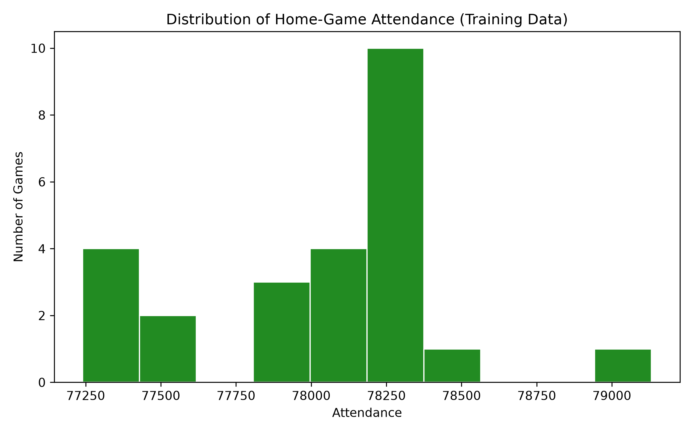
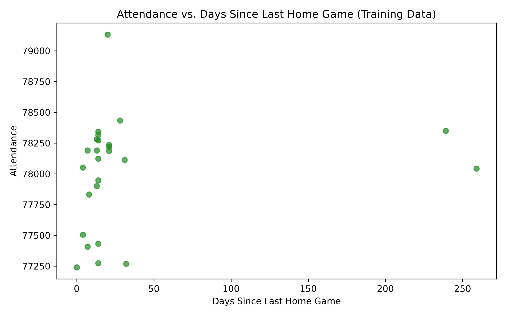
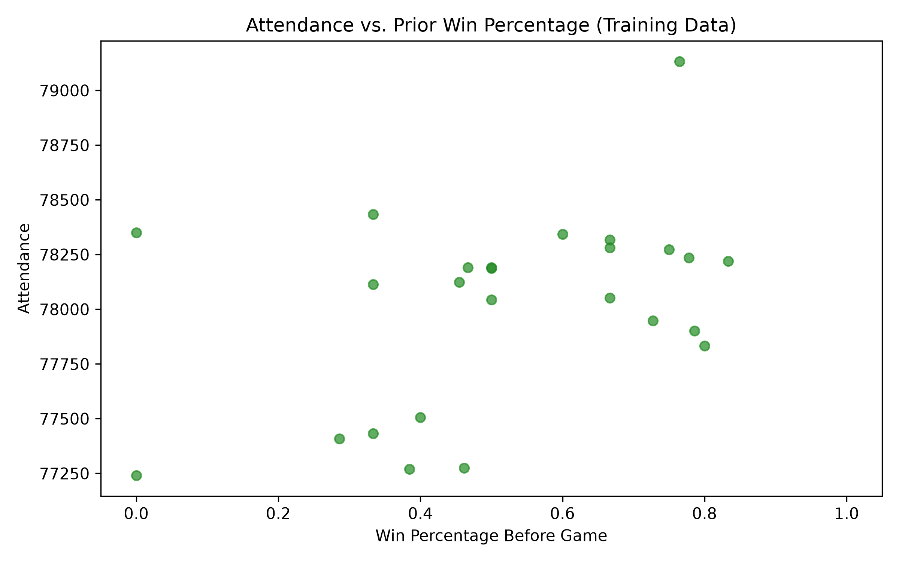
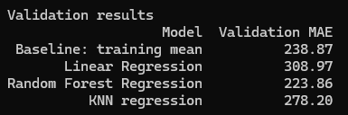

# Model Report

### Figures

Attendance was fairly consistent across training games, with most games drawing around 78,000–78,400 and there being 10 games with attendance around 78,250.

There doesn't appear to be a clear relationship between attendance and days since the last home game, with attendance after long offseason breaks falling within the range seen after shorter gaps.

There appears to be a slight postive relationship between games with higher prior win percentages and higher attendance.

### Error Measure
I used mean absolute error (MAE), which measures how many fans my attendance predictions were off by on average, regardless of whether they were too high or too low. For example, an MAE of 480 means the predictions differed from actual attendance by an average of 480 fans. A lower MAE indicates more accurate predictions.

### Comparison Table

### Model Chosen

I choose the Randome Forrest model as it was the only model that had a lower MAE thant he base MAE at 223.86.

Its test score ended up being much higher at 351.2.

### Top Features

### limits